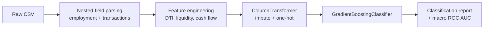

<div align="center">

# Fintech Loan Approval Classifier

**Predicting loan outcomes — `approved`, `pending`, or `rejected` — from customer, account, and transaction signals.**

[](https://www.python.org/)
[](https://scikit-learn.org/)
[](https://pandas.pydata.org/)
[](LICENSE)
[](https://github.com/janidu20050306/fintech-loan-status-classifier)
[](https://github.com/janidu20050306/fintech-loan-status-classifier)

</div>

---

## Why this project?

Loan application data is messy: employment history and flagged transactions are stored as nested, stringified records. This project shows a clean, end-to-end baseline — from parsing that raw data to a reproducible scikit-learn pipeline with honest evaluation — in a single, readable script.

## Dataset at a glance

| Property | Value |
| --- | --- |
| Records | 1,000 customers |
| Raw columns | 34 |
| Target | `Loan Application Summary.loan_status` |
| Classes | `approved`, `pending`, `rejected` |

The CSV combines four logical tables:

| Prefix | Contents |
| --- | --- |
| `Transaction Description` | List of flagged transactions per customer |
| `Customer Profile.*` | Age, occupation, income level, education, marital status, region, employment history |
| `Account Activity.*` | Balances, deposits, withdrawals, transfers, investments |
| `Loan Application Summary.*` | Loan amount, term, interest rate, employment status, and the target |
| `Time Series Data.*` | Monthly transactions and repayments |

## Pipeline



### Feature engineering

| Feature(s) | Source | Description |
| --- | --- | --- |
| `emp_avg_income`, `emp_total_years`, `emp_job_changes` | Employment history | Average historical income, total years worked, number of jobs |
| `flagged_tx_count`, `flagged_tx_total_amount` | Flagged transactions | Volume and value of suspicious activity |
| `income_level_clean` | Income level | Missing values filled from average employment income |
| `dti_ratio` | Loan + income | Loan amount vs. annualized income |
| `liquidity_buffer` | Balance + loan | Account balance vs. loan amount |
| `net_cash_flow` | Account activity | Deposits minus withdrawals |

## Results

Stratified 80/20 hold-out split, `random_state=42`.

| Metric | Score |
| --- | ---: |
| Accuracy | **0.70** |
| Macro F1 | **0.66** |
| Weighted F1 | **0.71** |
| Macro ROC AUC (OVR) | **0.859** |

| Class | Precision | Recall | F1 | Support |
| --- | ---: | ---: | ---: | ---: |
| `approved` | 0.98 | 0.92 | 0.95 | 89 |
| `pending` | 0.51 | 0.51 | 0.51 | 57 |
| `rejected` | 0.51 | 0.56 | 0.53 | 54 |

> `approved` is classified reliably. `pending` and `rejected` are the main improvement targets — see the roadmap below.

## Quick start

```bash
git clone https://github.com/janidu20050306/fintech-loan-status-classifier.git
cd fintech-loan-status-classifier

python -m venv .venv
.venv\Scripts\activate        # Windows
# source .venv/bin/activate   # macOS / Linux

pip install -r requirements.txt
python main.py
```

Requires Python 3.10+. Pinned versions live in [`requirements.txt`](requirements.txt).

## Project structure

```
fintech-loan-status-classifier/
├── main.py             # Parsing, feature engineering, training, evaluation
├── sampleDataset.csv   # Input data (1,000 records, 34 columns)
├── requirements.txt    # Pinned dependencies
├── .gitignore
├── LICENSE
└── README.md
```

## Roadmap

- [x] Parse nested employment and transaction fields
- [x] Engineer financial ratio features
- [x] Train and evaluate a reproducible baseline
- [ ] Add class weights or resampling for `pending` / `rejected`
- [ ] Tune hyperparameters with cross-validation
- [ ] Add confusion matrix and per-class ROC AUC
- [ ] Persist the trained pipeline with `joblib`
- [ ] Serve predictions through a small API

## Contributing

Issues and pull requests are welcome. For major changes, please open an issue first to discuss what you would like to change.

## License

Released under the [MIT License](LICENSE).
